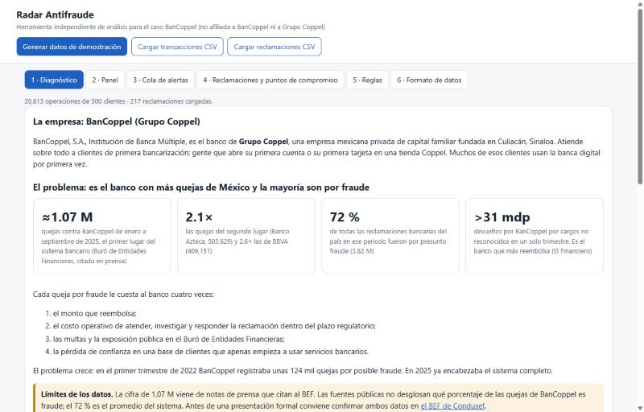
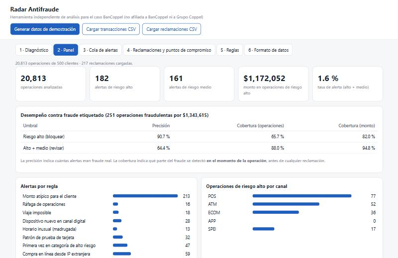
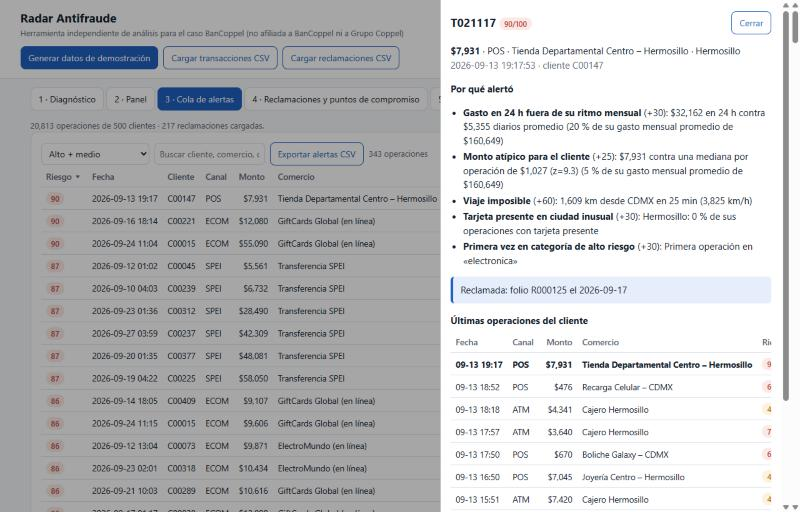
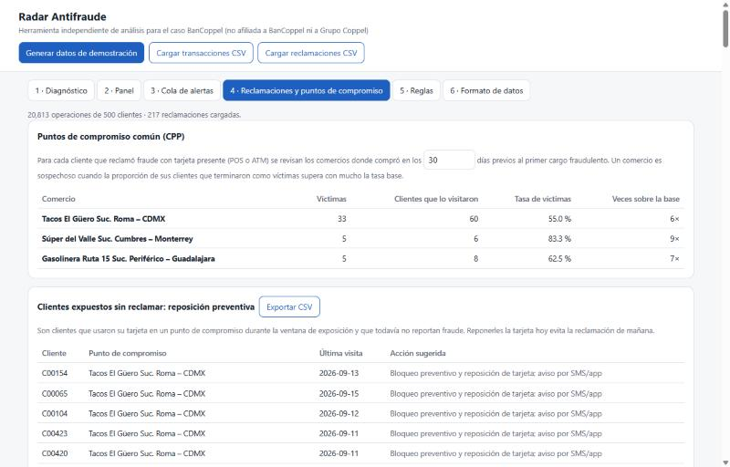
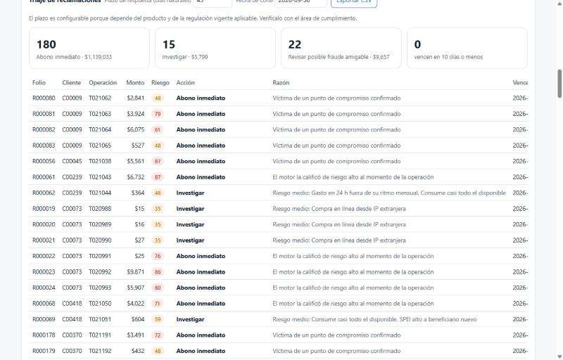

# 04 · Radar Antifraude — fraud and complaints radar for Mexico's most-complained-about bank

> **Showcase only.** This folder shows what the system does and the evidence that it works. The source code
> is **proprietary and kept in a private repository**; it is not covered by this portfolio's MIT license
> (see [NOTICE](NOTICE.md)). A live demo or a code walkthrough is available on request.

BanCoppel, the bank of Mexican family-owned Grupo Coppel, received **≈1.07 million complaints from January to
September 2025**, more than any other bank in Mexico and over twice the runner-up (Banco Azteca, 503,629). Across
the banking system, **72 % of complaints in that period were for suspected fraud**. Each complaint costs a refund,
the work of answering it within the regulatory deadline, regulatory exposure and the trust of customers who are
often banking for the first time.

Fraud leaves patterns in data the bank already has. Radar Antifraude reads card and transfer operations plus the
complaints, and:
- **scores every operation 0–100 and says why**, at the moment it happens, before anyone complains;
- **finds the shop where cards were cloned** and lists the customers who were exposed there but have not complained yet, so their cards can be replaced first;
- **triages every complaint**: refund now, investigate, or possible "friendly fraud", with its response deadline.

*Herramienta independiente, sin afiliación con BanCoppel ni Grupo Coppel, construida con información pública y datos sintéticos. Califica cada operación con reglas explicables, encuentra el comercio donde se clonaron las tarjetas, avisa a los clientes expuestos antes de que reclamen y prioriza las reclamaciones con sus plazos.*

> Runs on **synthetic data**: 500 customers, 30 days, ≈20,800 operations, three fraud schemes. No real bank data is
> used. Real performance has to be measured in a shadow-mode pilot (see *Honest limits*).

## How it works

| The bank needs | What Radar Antifraude does |
|---|---|
| Catch fraud while it happens | **12 explainable rules** compare each operation with *that customer's* own history: impossible travel between two card-present operations, a city the customer never uses, card-testing (several tiny online charges, then a big one), new device in a digital channel, a transfer to a never-used beneficiary, night-time activity, high-risk categories, foreign IP and more |
| Judge amounts like a person would | Amounts are weighed against the customer's **monthly spending** and their **available balance**, not fixed peso thresholds. That keeps low-balance customers protected, and they are most of this bank's clients |
| Find where cards were cloned | **Common point of compromise**: for each confirmed card fraud, it looks back at where the victim paid in the previous 30 days. A shop whose customers became victims at many times the base rate is the skimmer |
| Stop the next complaint | Lists the customers who **used a compromised shop and have not complained yet**, for preventive card replacement |
| Answer complaints faster and fairly | Each complaint is matched against the score its operation got: refund now (high risk or a confirmed compromise), investigate (medium), or review for possible friendly fraud (consistent with the customer's habits). Deadlines are tracked |
| Be accepted by Security and Compliance | Runs **entirely in the browser**, so no data leaves the bank's machine. Every alert lists the rules that fired and the evidence behind each one |

An **outreach agent** built on the Claude API completes the project. It drafts the first contact for each role (fraud, security, digital banking, complaints), reads replies, handles objections, proposes real free slots and books the meeting with a calendar invite. It runs two campaigns: selling a pilot to the bank, or partnering with the bank's card-platform vendor. **It only writes drafts: a person approves every message**, it never invents figures or clients, it always says that demo results are synthetic, and it respects a "no".

## Evidence

**Detection, measured against the labelled synthetic fraud** (251 fraudulent operations, MXN 1.34 M):

| Threshold | Use | Precision | Fraud caught (operations) | Fraud caught (amount) |
|---|---|---|---|---|
| High risk | block | **90.7 %** | **65.7 %** | 82.0 % |
| High + medium | review | 64.4 % | **88.0 %** | **94.8 %** |

Only **1.6 %** of operations are flagged for review.

- **Compromised shops:** it finds **all 3** seeded skimmers (6×–9× the base victim rate) and lists 30 exposed customers who had not complained yet.
- **Weighing by available balance helps.** Turning that rule on raised high-risk detection from **58 % to 66 %** with no loss of precision. It also took a 1 a.m. account takeover that drained 85 % of a small account from a score of 48 to **71**.
- **Automated tests:** **14 tests pass** in the private repository's CI. Eight run against the tool itself and check precision, recall, alert rate, that every alert explains itself, the three skimmers found and the triage deadlines. Six check the agent offline: calendar rules, drafts that are never auto-sent, and campaign prompts.

| Panel: precision and coverage at each threshold | One alert, explained |
|---|---|
|  |  |
| **The shops where cards were cloned, and who is still exposed** | **Complaint triage with deadlines** |
|  |  |

The alert above shows a cloned card: purchases in CDMX and ATM withdrawals in Hermosillo, 1,609 km apart, alternating within minutes. The original card is with its owner and the clone is somewhere else. MXN 32,162 left in 24 hours, 20 % of the customer's monthly spending.

## Honest limits

- **Synthetic data.** The fraud schemes are modelled on known patterns, but a real bank's data is messier. The rules and weights have to be calibrated in a shadow-mode pilot.
- **Impossible travel flags both sides.** It proves there are two cards, not which one is the clone, so legitimate purchases next to the clone are flagged too. The right action, blocking and replacing the card, is the same.
- **Public figures need checking.** The complaint figures come from press reports that cite Condusef's Buró de Entidades Financieras. Public sources do not break down how much of BanCoppel's own complaints is fraud; the 72 % is the system-wide figure.
- **It complements an existing fraud system; it does not replace one.** Its edge is explainability, the compromised-shop analysis and complaint triage.

## Built with

Vanilla JavaScript (single file, no dependencies) · Python · Claude API (tool use) · Node test runner · pytest ·
GitHub Actions.

*Sources: Condusef's Buró de Entidades Financieras as reported by the press, El Financiero (refunds for unrecognised
charges), Expansión (fraud claims in H1 2026, MXN 11,213 M).*
