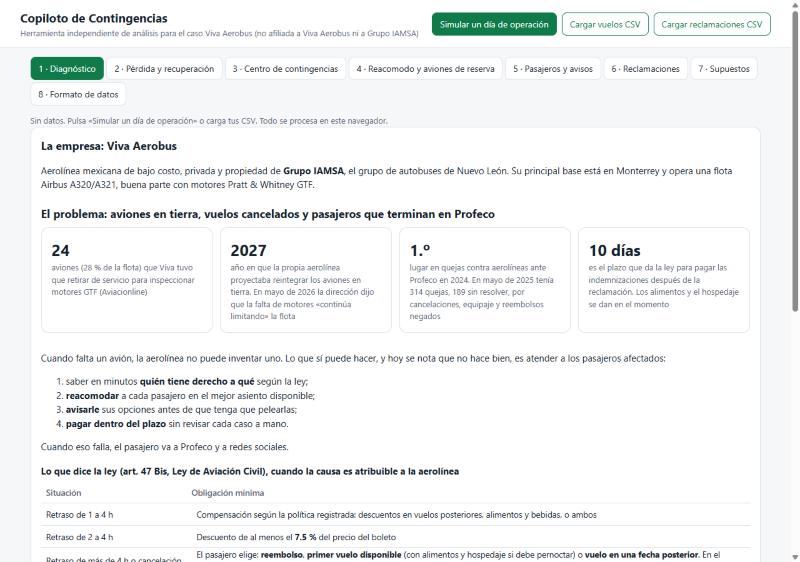
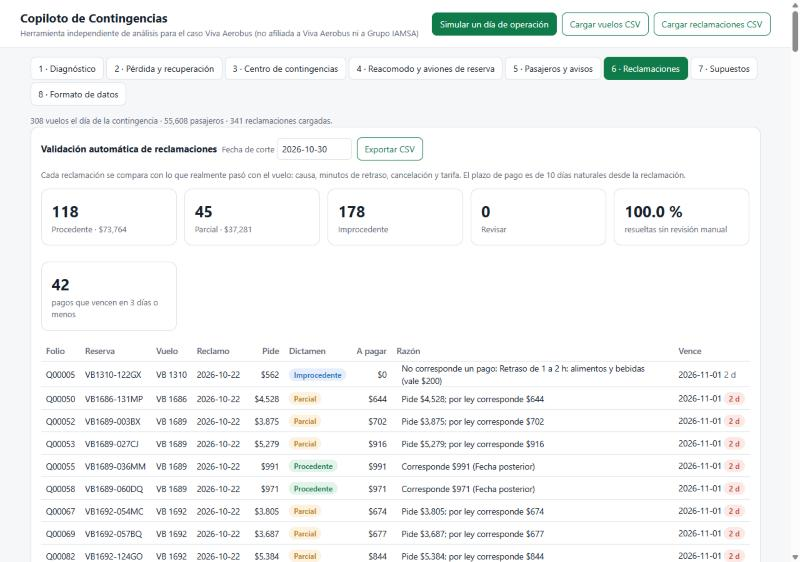

# 05 · Copiloto de Contingencias — passenger-rights copilot for an airline's grounded-fleet crisis

> **Showcase only.** This folder shows what the system does and the evidence that it works. The source code
> is **proprietary and kept in a private repository**; it is not covered by this portfolio's MIT license
> (see [NOTICE](NOTICE.md)). A live demo or a code walkthrough is available on request.

**Designed around the case of Viva Aerobus.** This tool was built, on my own initiative, for the real problem the
Mexican low-cost airline Viva Aerobus is living through — not as a job it gave me. **The airline does not use it**
and took no part in building it; it is independent work, with no affiliation to Viva Aerobus or Grupo IAMSA, built
on public information and synthetic data.

## The problem it solves

Viva Aerobus grounded as many as **24 aircraft (28 % of its fleet)** over the Pratt & Whitney GTF engine recall, and
in May 2026 its management said the shortage of engines still limits the fleet. It was the airline with **the most
complaints before Profeco in 2024**. A missing aircraft is not a software problem — but what happens to the stranded
passenger is. Mexican law (art. 47 Bis of the Ley de Aviación Civil) says exactly what each passenger is owed —
food, a 7.5 % discount, a 25 % indemnity, hotel — and that it has to be **paid within 10 days**. When that is handled
late or wrong, the passenger ends up in a refund plus an indemnity, and in a complaint before Profeco.

## What it costs them, and what the tool recovers

The copilot does **not** recover what is lost to fuel or to the grounded engines. It recovers what is lost by
**handling the contingencies badly**: passengers who are never re-accommodated and end up in a refund *plus* an
indemnity, claims that are overpaid, manual claim review, and avoidable Profeco complaints. From Viva's own public
2025 figures (25.65 M passengers, MXN 1,778 revenue per passenger) plus the simulation:

| Item | Lost today / year | With the tool | Recovered |
|---|---|---|---|
| Refunds + indemnities for passengers never re-accommodated | $268.5 M | $58.7 M | **$209.9 M** |
| Overpaid claims | $8.0 M | $0 | **$8.0 M** |
| Manual claim review | $10.1 M | $0.5 M | **$9.6 M** |
| Avoidable Profeco complaints | $6.8 M | $4.1 M | **$2.7 M** |
| **Total per year** | **≈ $293 M** | **≈ $63 M** | **≈ $230 M (≈ US$12.4 M)** |

**Range:** conservative (they already re-accommodate 85 % today) recovers **$109 M**; wide (60 %) recovers **$305 M**.
The single assumption that moves the result most is **how many passengers they re-accommodate today** — each 10 points
they already achieve subtracts about **$56 M** from what is recoverable. That number only Viva has, and it is the first
thing a one-week shadow pilot measures. Figures are in MXN and rest on public data plus editable assumptions.

## What it offers

- **The rights, computed passenger by passenger.** For each disrupted flight it classifies the cause (attributable to
  the airline or not) and works out, per passenger, what is owed under art. 47 Bis: food, a 7.5 % discount, refund,
  25 % indemnity and hotel.
- **Re-accommodation all the way to the final destination.** Every passenger carries their full itinerary. It catches
  cancellations and **missed connections — even from delays under 1 h**, which today go unseen — and re-routes each
  passenger from where they are to their **final destination**, direct or via a connection, without overselling a
  single flight. In the simulated day, **1,288 of 1,401 stranded passengers (91.9 %)** were re-accommodated.
- **Pay what is fair, on time.** Every claim is adjudicated automatically — valid, partial or not owed — with the exact
  amount and the 10-day deadline. Overpayments and invalid claims are flagged with the reason. In the demo, **100 %**
  of claims were resolved with no manual review.
- **Fleet decisions with numbers.** It assigns the spare aircraft to the grounded rotations that recover the most
  passengers, and prices each one: on a bad day, going from 2 to 4 spares drops the cost from **$3.0 M to $2.4 M**.
- **Runs entirely in the browser.** No install, and the data never leaves the airline's machine.

| The grounded-day control center | Re-accommodation to the final destination |
|---|---|
|  |  |
| **The public evidence behind the problem** | **Automated claim adjudication with deadlines** |
|  |  |

## Evidence (simulated day, synthetic data)

308 flights, ≈55,600 passengers, 3 aircraft on the ground, a storm in Cancún and saturation in Mexico City:

- **63 flights disrupted** (6 cancelled; 14 with sub-1-hour delays that still broke connections).
- **1,401 passengers left without a flight** (1,072 by cancellation, 329 by missed connection); **1,288 (91.9 %)**
  re-accommodated to their final destination, **no flight oversold**.
- **329 missed connections surfaced**, 54 of them from delays under one hour — the ones that are invisible today.
- **100 % of claims adjudicated** with no manual review; overpaid and invalid claims flagged with their reason.

## Honest limits

- **Synthetic operations data.** The operational figures come from a simulation, and the annual calculation combines
  public data with assumptions. Real impact is what a shadow-mode pilot measures.
- **The key assumption is their current re-accommodation rate.** The base case uses 70 %; if they already do better,
  the recoverable amount drops about $56 M per 10 points — the pitch says so up front.
- **Legal interpretation is theirs to validate.** Applying the 25 % to the first available flight, and measuring missed
  connections by arrival at the final destination, are parameters their legal team confirms.
- **Never claims the Viva–Volaris merger is approved.** As of this writing the competition authorization was still
  pending.

## Built with

Vanilla JavaScript (single file, no dependencies, runs offline in the browser) · public sources (Expansión, AFAC,
Aviación­line) + synthetic data.

*The source lives in a private repository; this page shows it without distributing the code.*
