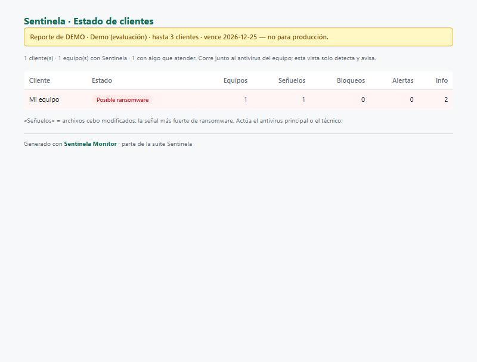
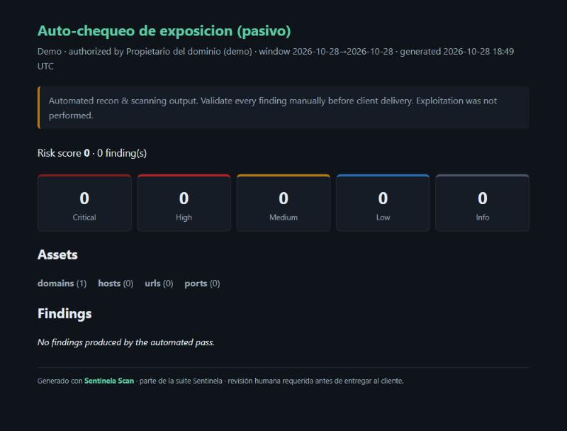

# 06 · Sentinela — ransomware early-warning (Monitor) and external-exposure check (Scan)

> **Showcase only.** This folder shows what the tools do and the evidence that they work. They ship as
> **proprietary binaries with no source code**; nothing executable, no signing keys and no license material are
> published here (see [NOTICE](NOTICE.md)). A live demo is available on request.

Two lightweight security tools for small businesses and the MSPs that serve them. Both run on Windows, store nothing
in the cloud, and are built to sit **next to** the existing antivirus rather than replace it.

---

## Sentinela Monitor — catches ransomware in the act

Antivirus catches known malware; it is slower at brand-new ransomware that simply starts encrypting files. Monitor
plants **decoy ("canary") files**, watches what changes, and raises the alarm the moment something begins encrypting —
**detect-and-alert only, it never touches processes or deletes anything.** Alerts are written to the Windows Event
Log, which an MSP's RMM already watches, and a scheduled task re-checks every 15 minutes as SYSTEM. One consolidated
panel rolls up every client and machine for the MSP.

**Demo (synthetic, in a temporary folder — real documents never touched):** decoys deployed, then a simulated
ransomware renamed one of them. On the next pass Monitor flagged **"Posible ransomware"** on the affected machine.

- **Early warning the antivirus can miss**: a touched decoy is the strongest early signal of mass encryption.
- **Safe by design**: only detects and reports — never blocks, quarantines or deletes.
- **Fits existing operations**: alerts land in the Windows Event Log; the MSP sees all tenants in one panel.
- **One-minute install per machine**, or run by hand against a single folder. Time-limited demo license.

---

## Sentinela Scan — external-exposure check for authorized engagements

A recon-and-scanning pipeline for security assessments. Everything is **scope-gated**: nothing runs against a target
that is not listed in a signed scope/authorization file. It separates a **passive** mode (read-only: DNS, TLS and
security headers — no authorization needed to check your own exposure) from an **active** mode that runs **only** with
written authorization. Output is a branded report (HTML / Markdown / PDF), a sales one-pager, and a `findings.json`,
each finding ranked by severity with a note that human review is required before client delivery.

**Demo (passive, read-only):** a self-check of **`example.com`** — the IANA-reserved example domain, so no third-party
systems are touched. It came back clean (risk score 0), which shows the report format and the scope/authorization
banner even with nothing to flag.

- **Authorization built in**: the scope file is the gate; out-of-scope targets simply never run.
- **Passive vs active, clearly separated**: check your own exposure safely; active testing needs a signed scope.
- **Client-ready output**: branded HTML/PDF report, severity dashboard, one-pager, machine-readable findings.
- **Human-in-the-loop**: every finding is marked "validate before delivery; exploitation not performed."

---

## Honest limits

- **Demo build, synthetic data.** The Monitor detection is a simulation in a temp folder; the Scan report is a clean
  passive check of a reserved example domain. Real deployments are measured on the client's own machines and scope.
- **Proprietary binaries, no source.** The executables, signing keys and license files are kept private and are not
  in this repository.
- **Monitor complements, Scan is for authorized use only.** Monitor runs alongside the antivirus and only alerts;
  Scan must only be pointed at targets you own or are authorized in writing to test.

*Built as independent work; part of the Sentinela suite.*
