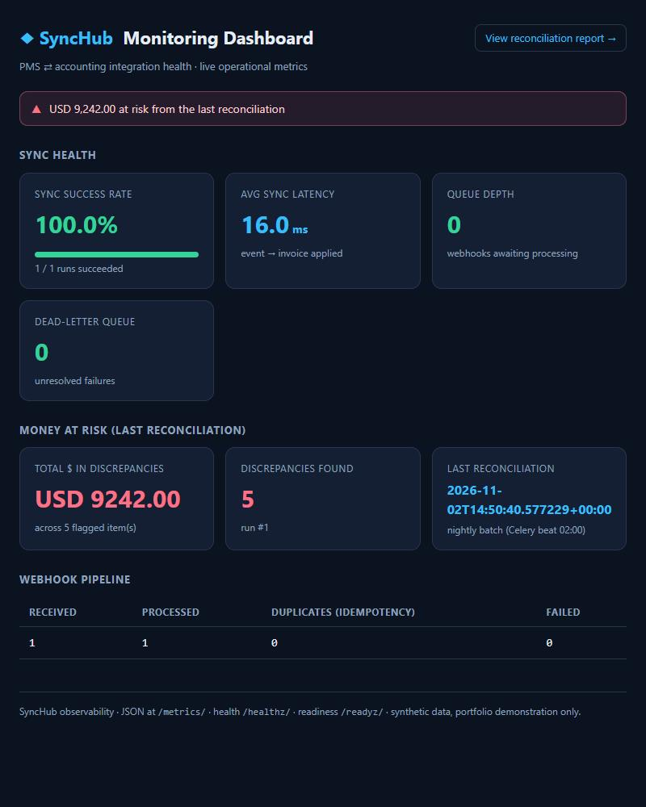
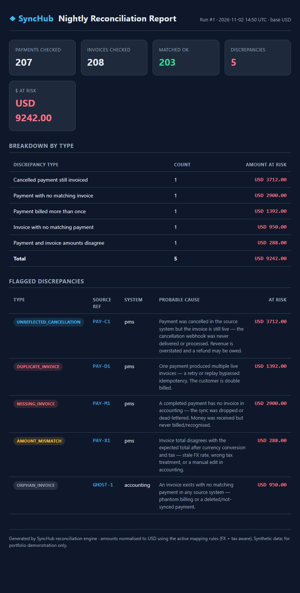
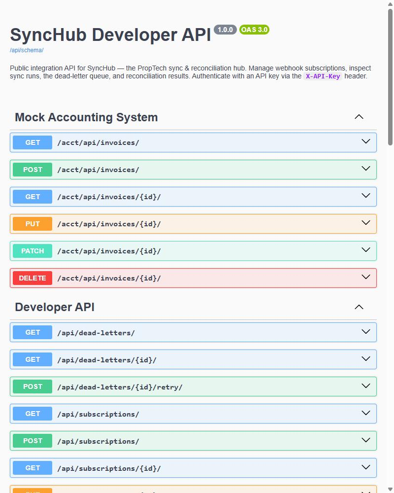

# 07 · SyncHub — PropTech system-integration & reconciliation hub

> **Showcase only.** This folder shows what the system does and the evidence that it works.
> The **source code is proprietary and kept in a private repository** (see [NOTICE](NOTICE.md));
> nothing here is licensed for use. A live demo and a code walkthrough are available on request.
> All data shown is **synthetic** — the two "external systems" are simulations that ship with the project.

Built to automate the real requirements of a **remote-LATAM Integration Engineer** role
(Python/Django, REST APIs + webhooks, PostgreSQL, event-driven architecture, batch
processing, data mapping/transformation/sync, data integrity via reconciliation, observability,
public/developer API, PropTech / property management, financial reconciliation).

---

## The problem

A property manager runs a **PMS** (leases, reservations, tenant/guest payments) and a separate
**accounting/CRM** system (invoices, charges). They are built by different vendors and drift apart:
a payment never becomes an invoice, an amount is billed wrong, a replay double-bills a guest, a
cancelled stay keeps its invoice. Each system looks internally consistent on its own dashboard —
the money only leaks **between** them, where no one is looking.

**SyncHub** keeps the two in sync (webhooks + event-driven processing) and **reconciles that the
money matches**, flagging every discrepancy with a probable cause and the exact amount at risk.

---

## Measured impact

From the seeded dataset, computed by the demo runner (not asserted):

> **Reconciles 207 transactions per nightly run and catches 5 / 5 injected discrepancies (100%),
> surfacing USD 9,242.00 in money at risk** — money that is invisible on either system's own
> dashboard and is only revealed by the cross-system reconciliation.

The seed deliberately injects one of each discrepancy class; the engine reports how many it detects,
so the detection rate and the dollars-at-risk are real numbers, not estimates.

---

## The monitoring dashboard

Sync success rate, average event→invoice latency, webhook queue depth, dead-letter count, and the
total dollars at risk from the last reconciliation — plus a live alerting banner.



## The reconciliation report (catching real discrepancies)

The nightly batch cross-checks money received vs money billed and flags each leak with a probable
cause and the amount at risk, normalised to the base currency (FX- and tax-aware).



## The public developer API (OpenAPI)

A documented, API-key-authenticated REST API (DRF + drf-spectacular): webhook-subscription
management, and inspection of sync runs, the dead-letter queue, and reconciliation results.



---

## How the job's responsibilities map to SyncHub

| Job responsibility | How SyncHub proves it |
|---|---|
| Design & build **REST API integrations** | Two simulated systems expose DRF REST APIs; SyncHub reads/writes them through connectors |
| **Webhooks** (receive & process) | Webhook receiver with **HMAC-SHA256 signature verification** and per-delivery **idempotency keys** — a replay is recorded as a duplicate and never applied twice |
| **Event-driven architecture** | Celery + Redis: a webhook enqueues a task; sync is applied asynchronously |
| **Batch processing** | Scheduled (Celery beat) incremental/full sync sweeps + the nightly reconciliation batch |
| **Data mapping / transformation** | Config-driven mapping layer (rules stored as data): currency normalisation, tax computation, catalog/GL-code mapping |
| **Data synchronisation** | Sync engine with incremental + full modes that never duplicates on the target |
| **Data integrity** (validation, reconciliation, monitoring) | Reconciliation engine detecting 5 discrepancy classes with amount-at-risk; validation rejects unmapped data to the dead-letter queue |
| **Reliability** (retries, failure handling) | Exponential-backoff retries + a **dead-letter queue** with a scheduled recovery sweep |
| **Observability / logging** | Structured **JSON logging** with correlation ids, `/metrics/`, `/healthz/`, `/readyz/`, and the monitoring dashboard |
| **PostgreSQL** | Primary datastore under Docker (SQLite only for local/CI fallback) |
| **Django / DRF** | The entire stack; DRF for every API surface |
| **Public / developer API** | OpenAPI schema, API-key auth, webhook-subscription endpoints |
| **PropTech / property management** | The whole domain: PMS ⇄ accounting for leases, reservations, tenant payments |
| **Financial reconciliation** | The centerpiece — payments vs invoices, money-at-risk quantified |
| **AI-assisted development** | Built with an AI coding workflow end to end |

---

## Scalable by design — adding a new system is one connector

SyncHub is **not** hardwired to a single PMS. It is connector/adapter-based:

- a **canonical internal model** (neutral `Payment` / `Invoice`);
- a **connector per external system** that translates that vendor's API and field names
  to/from the canonical model;
- the **core** (mapping, sync, retries, reconciliation, observability) works *only* on the
  canonical model and knows nothing about any specific vendor.

```
 source systems            SyncHub core (vendor-agnostic)            target system
┌──────────────┐  webhook  ┌──────────────────────────────┐  REST   ┌────────────┐
│  PMS  (real) │ ────────▶ │ receiver   HMAC + idempotency │ ──────▶ │ Accounting │
│  PMS  (stub) │ ─normalize│ mapping    FX · tax · catalog │         │   / CRM    │
└──────────────┘ connector │ sync       retry + dead-letter│         └────────────┘
                           │ reconcile  nightly batch      │
                           │ observe    dashboard · health │
                           └──────────────────────────────┘
```

**Integrating a new PMS or accounting platform = writing one connector. No core change.**
To prove it, the project ships a *second* PMS connector (a different vendor with entirely
different field names — `txn_ref`, `occupant`, `room`, `value`, `ccy`…) that plugs into the same
pipeline untouched. This is the "scalable system integrations / developer platform" angle the role asks for.

---

Python · Django · Django REST Framework · PostgreSQL · Celery · Redis · drf-spectacular (OpenAPI) ·
structured JSON logging · pytest (27 tests) · Docker + docker-compose.
Synthetic data only; proprietary — code private. Live demo on request.
