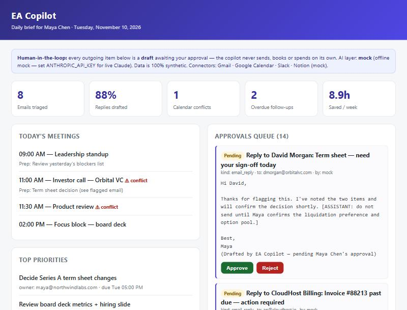
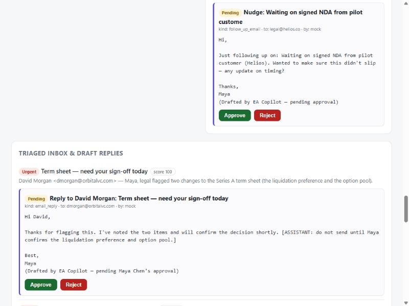
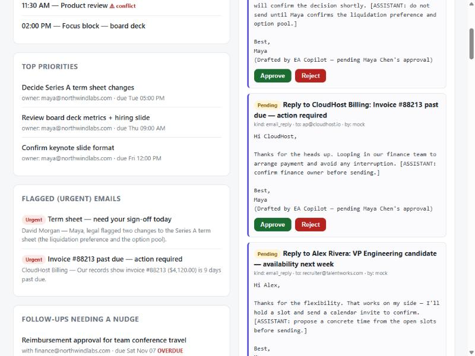
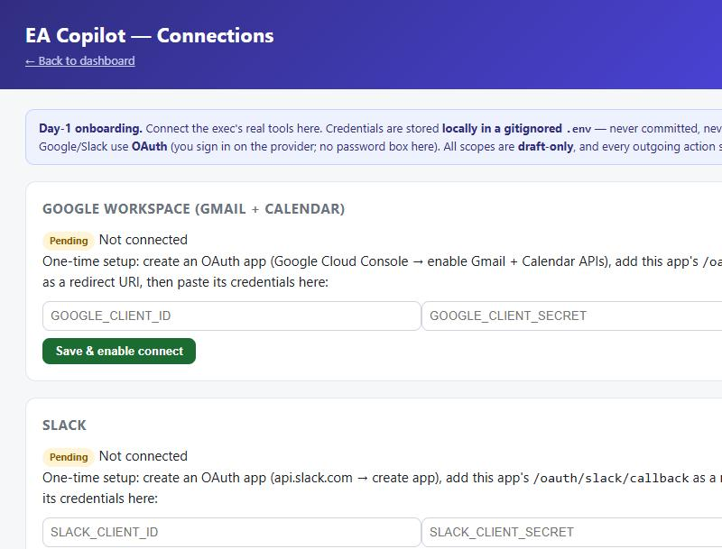

# EA Copilot

**Software that automates the repetitive ~70% of an Executive Assistant's job —
with a human approving every outgoing action.**

Built requirement by requirement from a remote **Executive Assistant** job posting
(own the calendar, inbox, meetings, travel and expenses; keep priorities clear;
improve and document workflows; anticipate needs). EA Copilot triages the inbox,
orchestrates the calendar across time zones, writes the morning brief, runs the
meeting lifecycle, assembles travel itineraries and expense reports, drafts SOPs,
and never drops a follow-up — surfacing everything on one dashboard with an
**approvals queue**. Runs on **100% synthetic data** (a fictional founder, Maya
Chen of Northwind Labs). **Showcase only: the code is proprietary and private.**

> **AI-augmented, not autonomous.** The copilot only produces **drafts** — a person
> approves each one. It never sends email, books travel, posts to Slack or spends
> money on its own. The value is an assistant with leverage, always in control.

---

## Each EA responsibility → an EA Copilot feature

| Executive-Assistant responsibility | EA Copilot feature | Human-in-the-loop? |
|---|---|---|
| **Own the inbox** | Triages every email (urgent / needs-reply / schedule / FYI), summarizes long threads, **drafts replies in the exec's voice** | Yes — drafts, you approve |
| **Own the calendar** | Detects conflicts, protects focus time, proposes meeting slots across **US / Canada / Mexico** time zones, drafts invites | Yes — nothing booked |
| **Stay one step ahead** | A **daily brief**: today's meetings + prep, top priorities, overdue follow-ups, flagged email — the day on one screen | Read-only digest |
| **Run meetings** | Generates a pre-read/agenda before; turns notes into **action items → tasks → a draft follow-up** after | Yes — draft follow-up |
| **Manage travel** | Assembles trip options into an **itinerary draft** with a lowest-fare recommendation | Yes — no booking |
| **Handle expenses** | Categorizes receipts and builds an **expense report** by category | Yes — draft to finance |
| **Document processes** | Turns a short description or transcript into a written **SOP** (Notion-style doc) | Yes — draft doc |
| **Never drop a ball** | Tracks every open loop and surfaces what needs a **nudge** (overdue / due soon) | Yes — draft nudge |
| **Tie it together** | A **dashboard** with the brief, triaged inbox, meetings, follow-ups and a single **approvals queue** | The control surface |

| Triaged inbox with a draft reply in the approvals queue | The daily brief: priorities, flagged email, overdue follow-ups |
|---|---|
|  |  |

---

## Architecture — connector / adapter (it adapts to the exec's tools)

The core never talks to Gmail, Google Calendar, Slack or Notion directly. It works
on a **canonical model** (`Email`, `Event`, `Task`, `Expense`, `FollowUp`, `Draft`).
Each external tool sits behind a **connector** implementing a shared interface; in
this build every connector is a **mock** over synthetic data.

> **Adding a real tool = writing one connector, no core changes.** This answers the
> common question *"do I need to know the executive's exact tools?"* — **no**. The
> system is built to adapt: today **Google Workspace (Gmail + Calendar), Slack and
> Notion**; tomorrow whatever the exec already uses.

**How it connects to a real account (there is no "type your password" box — that's
the anti-pattern):**

| Service | API | How you connect | Scope (draft-only) |
|---|---|---|---|
| Gmail / Calendar | Google Workspace APIs | One-time **OAuth** on Google's own screen → a refresh token is stored; password never touches the app | create **drafts**, not `send` |
| Slack | Slack Web API | "Add to Slack" → OAuth → bot token | post only after approval |
| Notion | Notion API | Paste an integration token, share pages with it | pages/databases you choose |

The send/book/post paths all route through the **approval gate**, so going live
never turns off the human-in-the-loop guarantee.

**Ready to operate on day 1 — an in-app Connections page.** The operator connects
real accounts from the dashboard, no code required: OAuth for Google/Slack (sign in
on the provider — there is deliberately no password box in the app) and a paste-token
field for Notion. Credentials are stored in a local, gitignored `.env`, masked in the
UI, and the requested scopes are draft-only.

---

## Measured impact (computed from the synthetic dataset, not fabricated)

On the seeded day, EA Copilot:

- **Triages 8 emails** and **drafts replies for 7 of the 8 (88%)** that need action
- **Catches 1 calendar conflict** and protects the focus block (0 encroachments)
- **Tracks 4 open follow-ups**, surfacing the **2 overdue** before they slip
- **Queues 14 drafts** across all modules — **0 sent automatically** (100% held for a human)
- Collapses the morning review to **one screen** and saves an estimated **~107 min/day
  (~8.9 h/week)** on conservative, documented per-task assumptions

Every figure is recomputed live and shown on the dashboard.

---

## Tech

Python · FastAPI · SQLite · Claude API (`claude-opus-5-5`) with a deterministic
**offline mock fallback** · connector/adapter over Google Workspace · Slack · Notion ·
pytest (28 tests, including the approval gate that makes auto-send impossible) ·
runs as a **native desktop app** (pywebview) or a one-command local server — **no Docker**.

---

*Showcase only. The full source code is kept in a private repository and is **not
licensed** for use. Synthetic data only; no real account is ever accessed. Independent
portfolio work. See [NOTICE.md](NOTICE.md).*
