# Portfolio — Automations of Software

Software built to automate the real requirements of job postings.
Each folder is an independent project: it takes a role's day-to-day tasks and turns the repetitive parts into tooling.

*Software construido para automatizar los requisitos reales de vacantes de empleo. Cada carpeta es un proyecto independiente.*

| # | Project | Role it targets | Status |
|---|---|---|---|
| 01 | [BI & KPI Analytics](01-bi-kpi-analytics/) | BI / Data Analyst (Amazon Quick Suite, SQL, AWS) | ✅ Done · showcase only, code private |
| 02 | [Made-to-Order BI](02-made-to-order-bi/) | BI Analyst for a custom furniture manufacturer | ✅ Done · showcase only, code private |
| 03 | [Sentinela Ductos](03-pipeline-theft-detection/) | Industrial software / SCADA data engineer (oil & gas) | ✅ Done · showcase only, code private |
| 04 | [Radar Antifraude](04-bank-fraud-radar/) | Fraud analytics / data scientist in retail banking | ✅ Done · showcase only, code private |
| 05 | [Copiloto de Contingencias](05-viva-contingencies/) | Ops / passenger-rights software for an airline in a grounded-fleet crisis | ✅ Done · showcase only, code private |

---

## 01 · [BI & KPI Analytics](01-bi-kpi-analytics/)

An end-to-end BI system on **real data from Olist**, a Brazilian marketplace (~100k orders,
2016–2018), built requirement by requirement from a BI Analyst job posting.

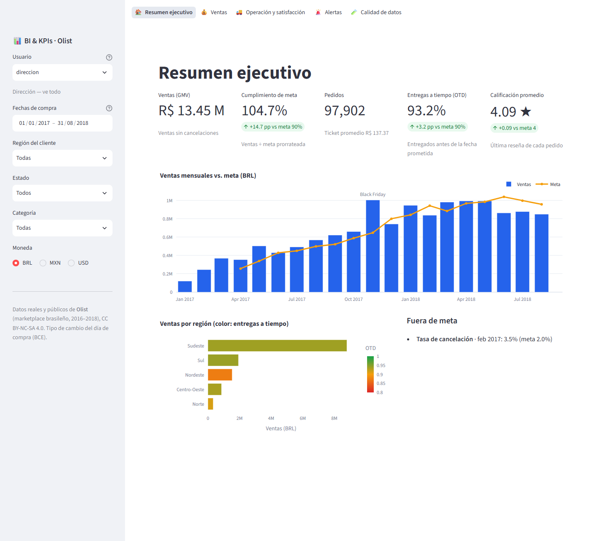

**What it offers**

- **Anomaly alerts that see trouble coming.** It flagged the May 2018 national truckers' strike
  **7 days before deliveries failed** — and each alert arrives with who acts, what to do and the
  list of orders at risk.
- **A dashboard for each role.** Directors see everything; regional managers, only their region;
  sellers, only their own sales — enforced in the query layer, with leak tests.
- **Numbers you can trust.** 30 data-quality checks, a quarantine for contradictory rows, and a
  reconciliation that refuses to publish if a single cent was lost.
- **KPIs in plain language.** 13 KPIs declared in configuration, in BRL / MXN / USD, against a
  sales plan — and a written reading of what happened for non-technical readers.
- **Ready for the cloud.** One command exports Parquet, Athena tables and QuickSight row-level
  security rules; every page loads in under a second.

| Anomaly alerts, with events and orders at risk | What each event cost |
|---|---|
| 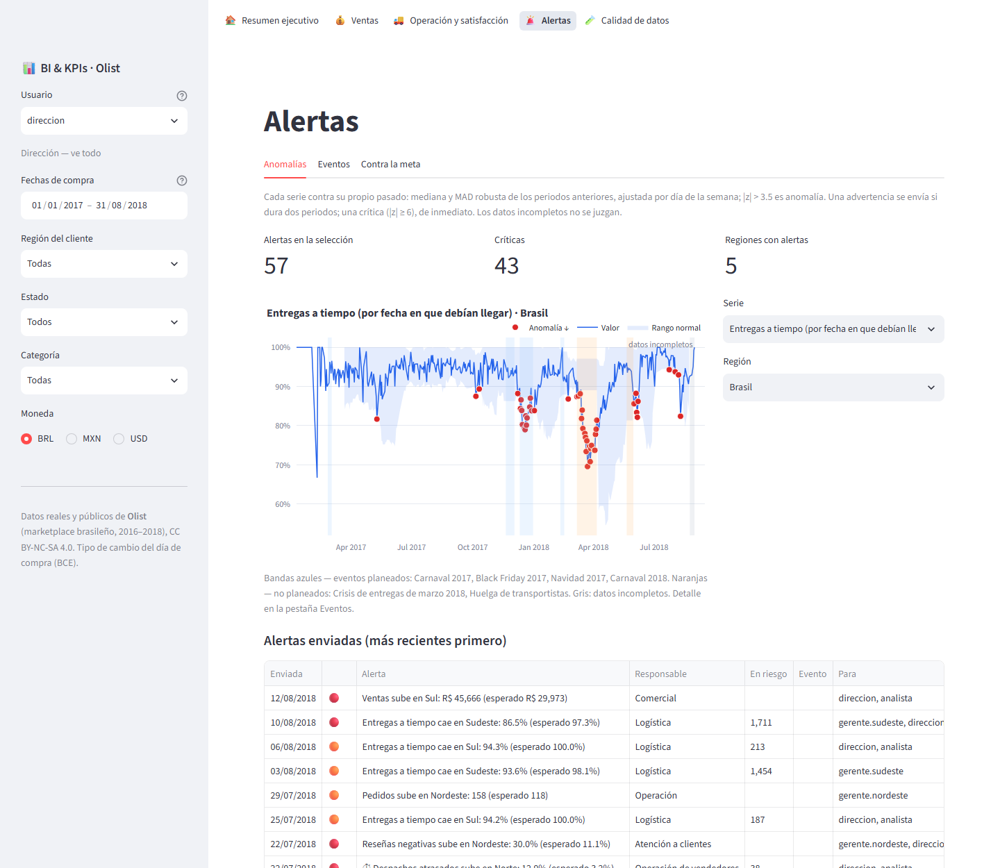 | 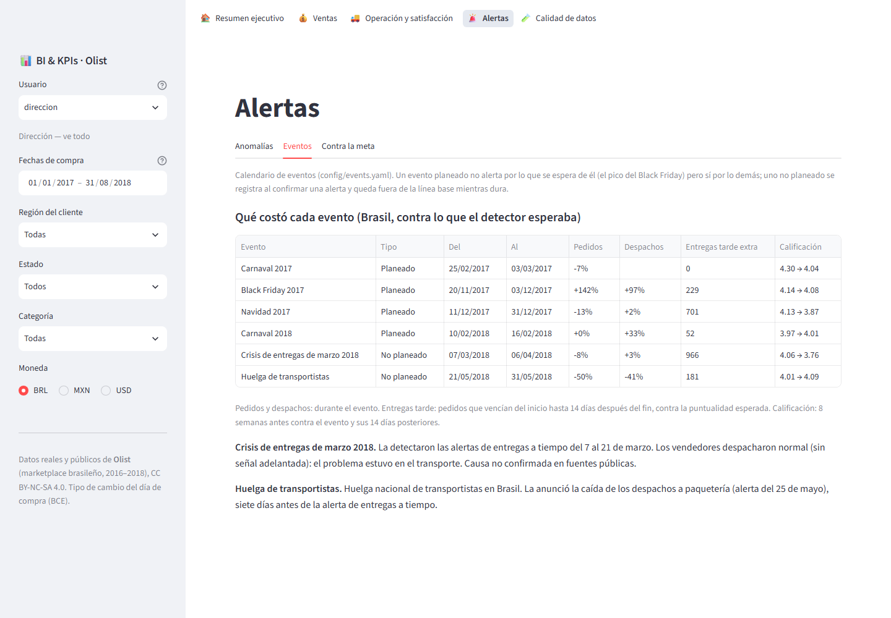 |
| **Operations & satisfaction** | **The same dashboard, as a regional manager** |
| 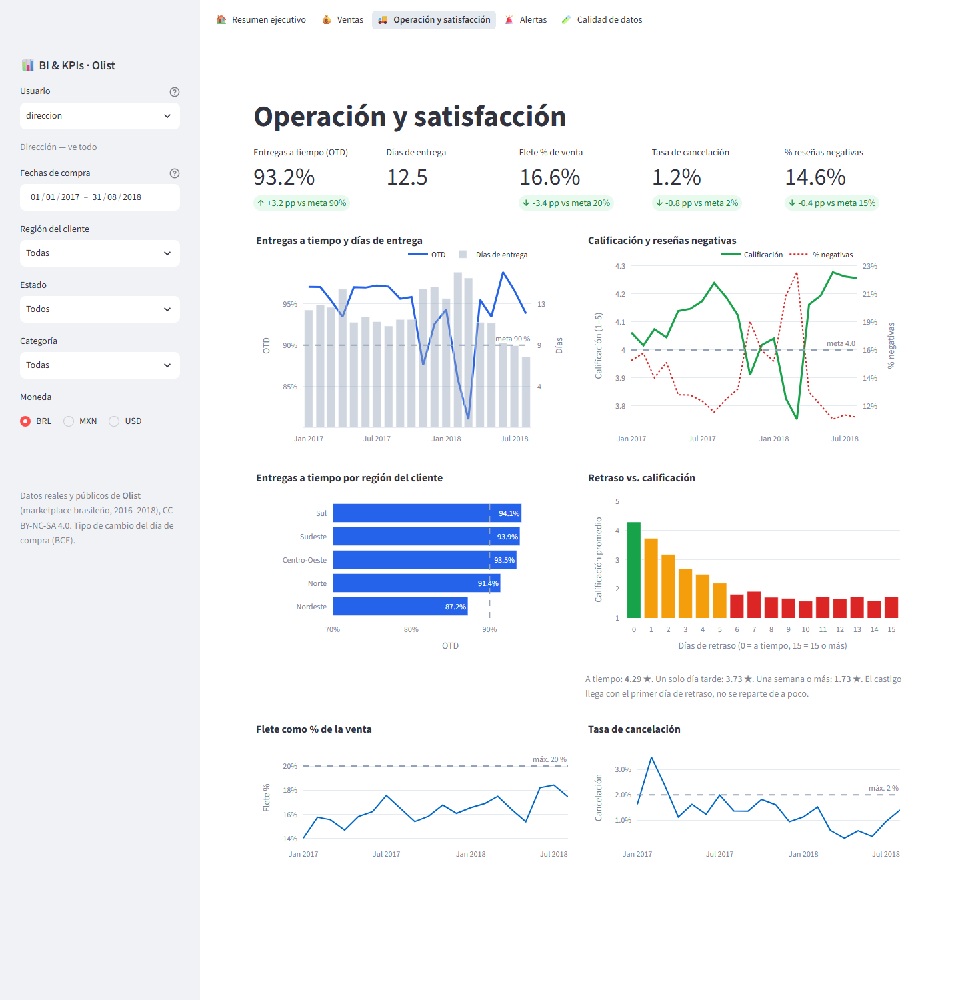 | 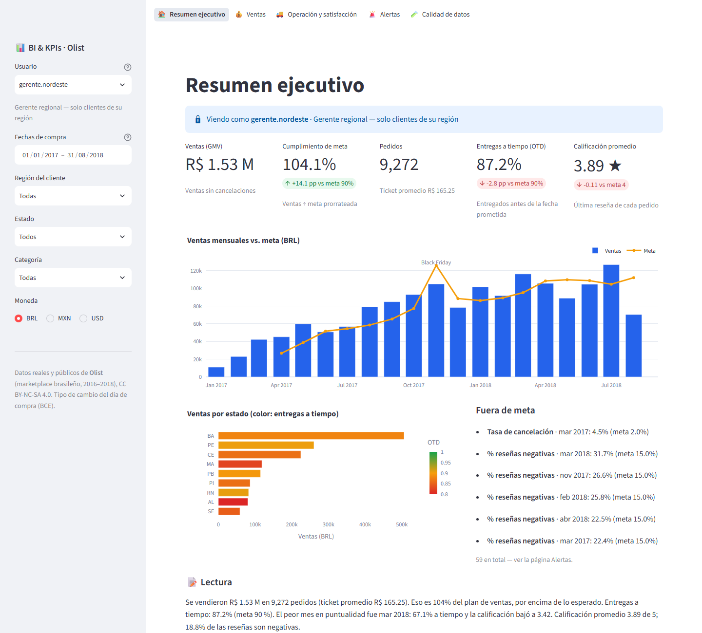 |

Python · SQL · DuckDB · Streamlit · Plotly · pytest (127 tests) · GitHub Actions ·
[Read more →](01-bi-kpi-analytics/)

---

## 02 · [Made-to-Order BI](02-made-to-order-bi/)

A web dashboard a small custom furniture workshop can run **without anyone technical in the
middle**: each area fills in an Excel template, administration drops in the SAT's invoice XML,
and everyone gets their own board. Built for a real furniture maker in Mexico; this repository
runs on a made-up workshop.

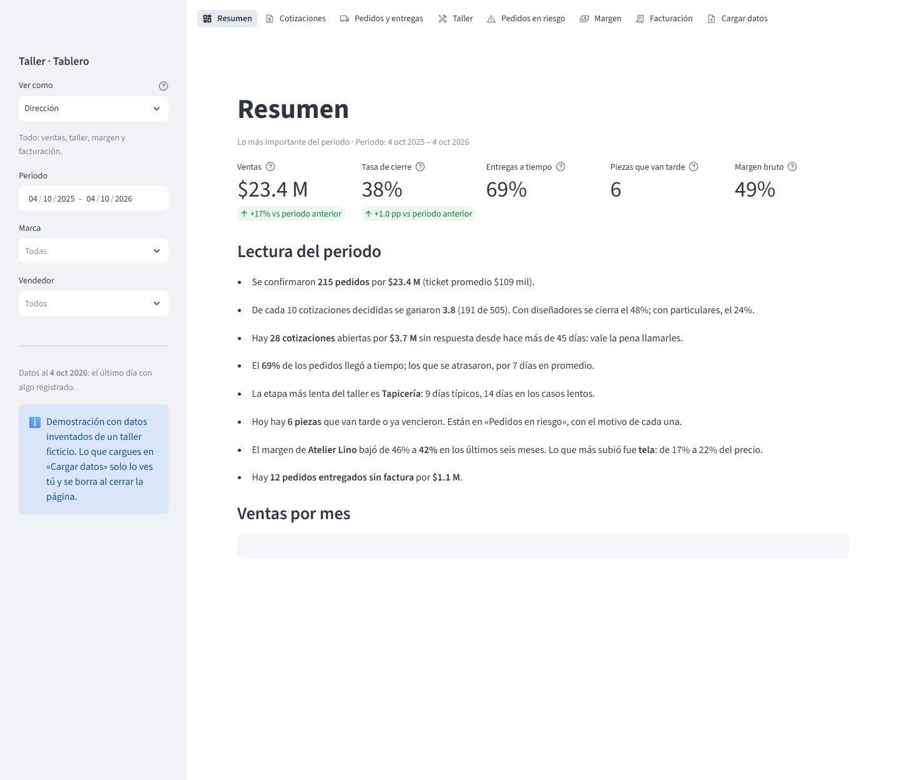

**What it offers**

- **Orders that will arrive late, before they do.** For each open piece: the stages it still
  needs at the shop's recent pace, an estimated date against the promise, and the reason. Checked
  against history: 72 % of the pieces it flags were late (guessing: 26 %), dates off by 2 days.
- **Excel in, no IT needed.** Templates with drop-down lists; Mexican formats understood; every
  mistake reported with its Excel row, the rest still loads.
- **SAT invoices as they come.** CFDI 3.3 and 4.0, loose or in the bulk-download ZIP: billed vs
  delivered, orders never invoiced, invoices with no order.
- **Close rate, shop-floor times and margin by piece and brand**, with a plain-language reading
  that says which margin fell and which cost explains it.
- **Each area sees its own.** Sales never sees costs; the shop never sees prices.

| Orders at risk, with the reason for each | Upload: every mistake with its row |
|---|---|
| 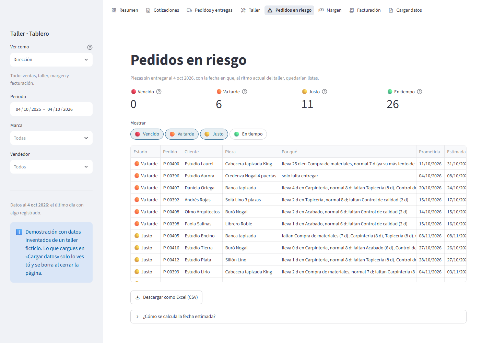 | 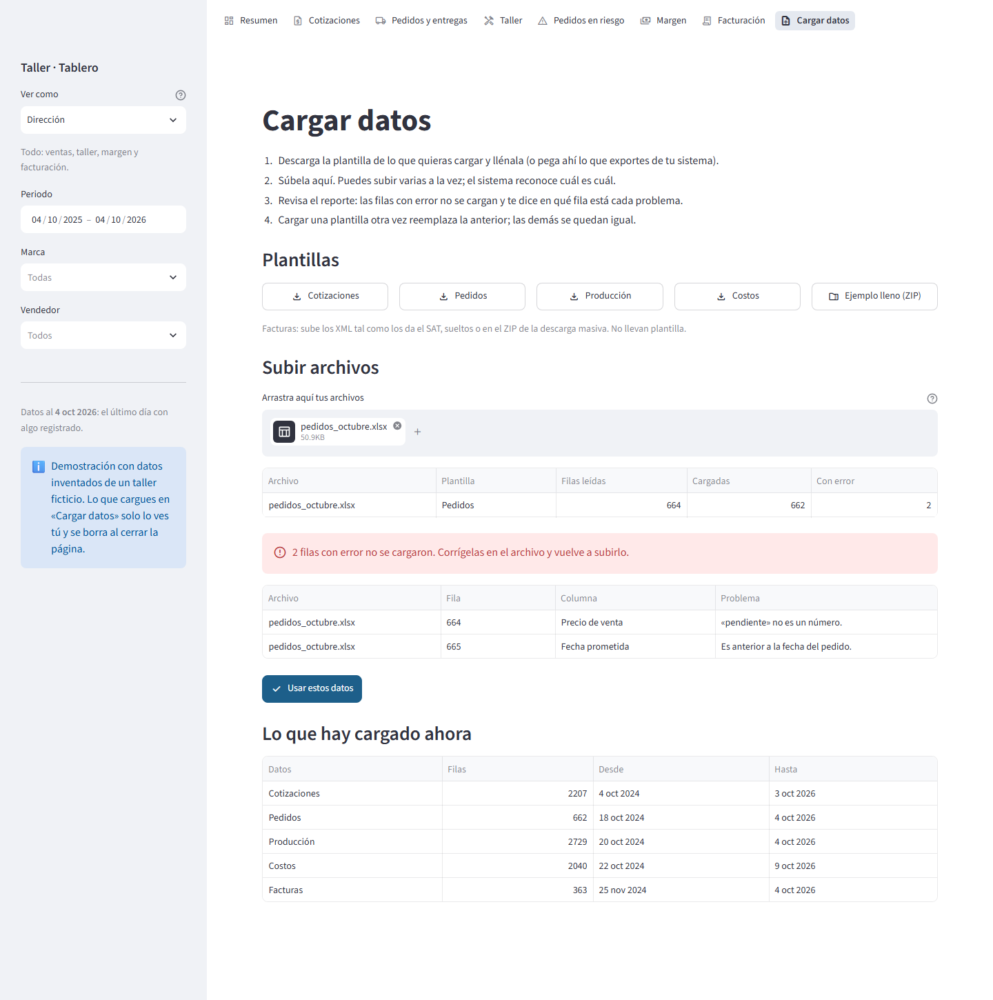 |

Python · pandas · Streamlit · Plotly · openpyxl · CFDI XML · pytest (83 tests) · GitHub Actions ·
[Read more →](02-made-to-order-bi/)

---

## 03 · [Sentinela Ductos](03-pipeline-theft-detection/)

Pemex lost **MXN 23.5 billion to fuel theft in 2025**: one illegal tap every 51 minutes, and the
tool that finds them takes about 30 days. Sentinela reads the pressure and flow a SCADA already
has and, **within minutes**, says there is a tap, at which km, which access road and brigade, and
how many litres are being stolen. Runs on a simulated pipeline.

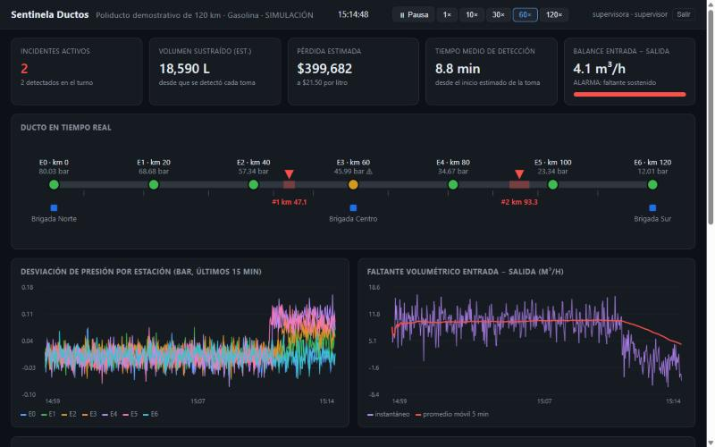

**What it offers**

- **A tap found in ~2.3 min and placed within a few hundred metres**, from the pressure wave the
  drilling sends down the line; slow-opening taps caught by the flow balance and the pressure profile.
- **No crying wolf.** Pump maneuvers (even unlogged ones) and failing transmitters are told apart:
  0 false alarms in 2 simulated days; 100 % detection from 5 m³/h in a 160-tap Monte Carlo campaign.
- **Live SCADA data as it really arrives**: HTTP and encrypted OPC-UA, with late, lost and junk
  readings handled so a data gap is never read as a tap.
- **Ready to run 24/7**: roles and audit trail, HTTPS, hot backups, restart without losing the
  shift, and a watchdog that pages the on-call team on Telegram.

| Incidents, each step signed by who did it | SCADA link and data quality |
|---|---|
| 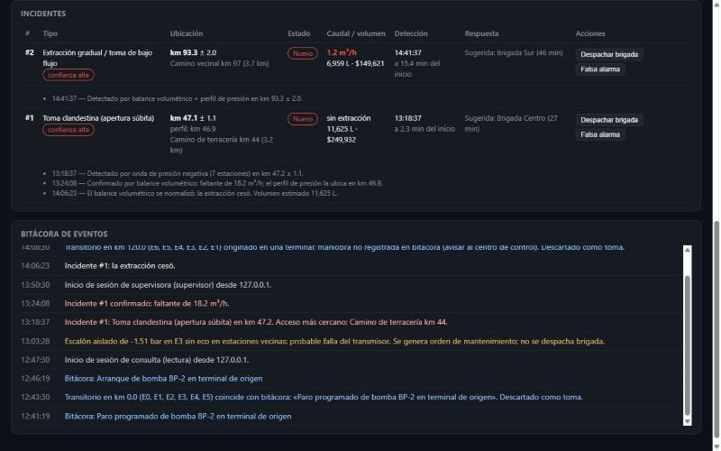 | 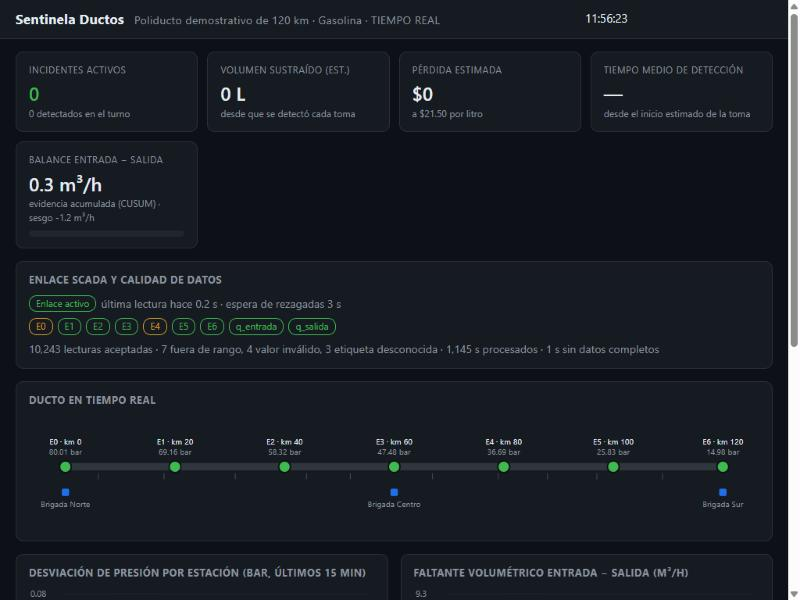 |

Python (standard library) · SQLite · OPC-UA · vanilla JS · 37 tests · GitHub Actions ·
[Read more →](03-pipeline-theft-detection/)

---

## 04 · [Radar Antifraude](04-bank-fraud-radar/)

**Designed around the case of BanCoppel** — the bank of Mexican family-owned Grupo Coppel — as independent work;
**the bank does not use it** and took no part in building it. BanCoppel received **≈1.07 million complaints in the
first nine months of 2025**, the most of any bank in Mexico, and most complaints across the system are fraud;
Expansión put fraud claims against it at **MXN 11,213 M in the first half of 2026**. Each complaint is a refund, the
work of answering it within the deadline, regulatory exposure and lost trust — money lost by catching fraud late and
answering complaints by hand, which is exactly what software recovers. Radar Antifraude scores every operation as it
happens and says why, finds the shop where cards were cloned, warns exposed customers before they complain, and
triages complaints with their deadlines. Runs on synthetic data. **Showcase only: the code is proprietary and private.**

**What it offers**

- **Fraud caught at the moment of the operation**: 91 % precision on the block threshold; 88 % of fraud
  (95 % of the amount) caught on the review threshold, flagging only 1.6 % of operations.
- **Amounts judged like a person would**: against the customer's monthly spending and available balance, which
  protects low-balance customers and lifted high-risk detection from 58 % to 66 %.
- **The skimmer, found**: all 3 compromised shops identified from the complaints, plus the list of exposed
  customers who have not complained yet.
- **Every alert explains itself**, and an AI outreach agent drafts the pitch and books the meeting, with a person
  approving every message.

| One alert, explained | Where the cards were cloned |
|---|---|
|  |  |

Vanilla JS · Python · Claude API · 14 tests · GitHub Actions ·
[Read more →](04-bank-fraud-radar/)

---

## 05 · [Copiloto de Contingencias](05-viva-contingencies/)

**Designed around the case of Viva Aerobus**, the Mexican low-cost airline that grounded up to **28 % of its fleet**
over the Pratt & Whitney engine recall and was the airline with the most Profeco complaints in 2024 — built as
independent work; **the airline does not use it**. A missing aircraft is not a software problem, but what the airline
owes each stranded passenger is: food, discounts, a 25 % indemnity and hotel under art. 47 Bis, paid within 10 days.
Handling that badly costs Viva about **MXN 293 M a year**; the copilot recovers roughly **MXN 230 M (≈ US$12.4 M)**
of it. Runs on synthetic data. **Showcase only: the code is proprietary and private.**

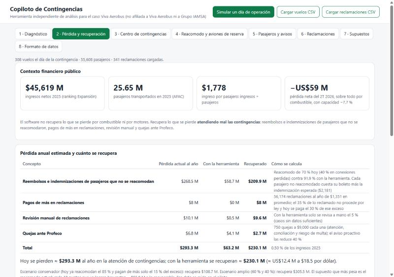

**What it offers**

- **The rights of every passenger, computed one by one** under art. 47 Bis, with the cause classified as attributable
  or not.
- **Re-accommodation to the final destination** — catching missed connections even from sub-1-hour delays, which go
  unseen today: **1,288 of 1,401 stranded passengers (91.9 %)** re-routed, no flight oversold.
- **Fair claims, paid on time**: 100 % of claims adjudicated automatically with the exact amount and the 10-day
  deadline; overpaid and invalid claims flagged with the reason.
- **Fleet decisions with numbers**: spare aircraft assigned to the rotations that recover the most passengers.

| The grounded-day control center | Re-accommodation to the final destination |
|---|---|
| 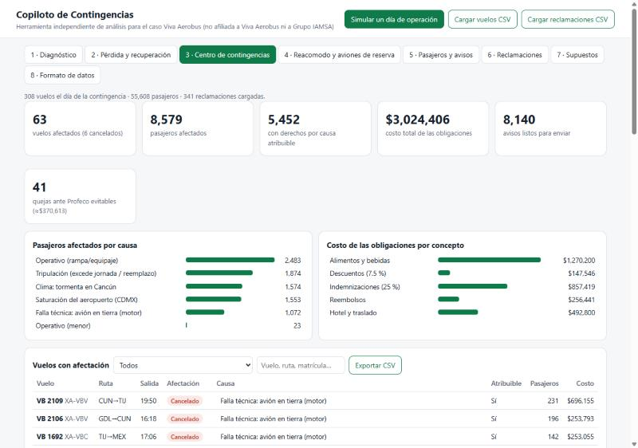 | 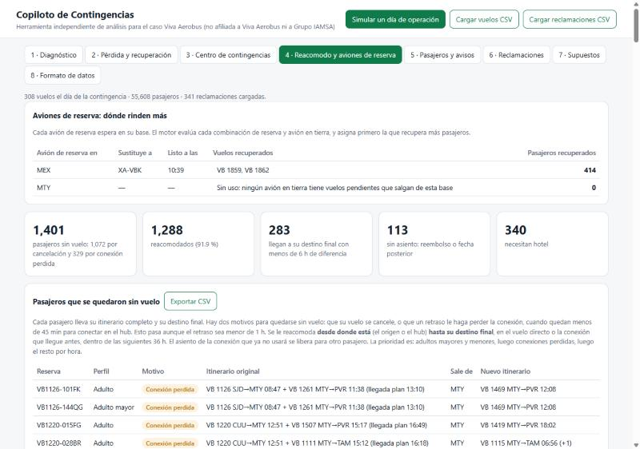 |

Vanilla JS (single file, runs offline) · public sources + synthetic data ·
[Read more →](05-viva-contingencies/)

---

## Also see

- [GovIntel MX](https://github.com/nitoramber-svg/GovIntel-MX) — procurement intelligence platform over 520k+ Mexican public contracts (FastAPI, PostgreSQL, Celery, Docker).

## License

All projects here are **showcase only**: each folder shows the work and the evidence that it works, but the
**source code is proprietary and kept in private repositories**. It is **not licensed** — no permission is granted
to use, copy, reproduce or build on it without prior written permission (see each folder's NOTICE:
[01](01-bi-kpi-analytics/NOTICE.md), [02](02-made-to-order-bi/NOTICE.md), [03](03-pipeline-theft-detection/NOTICE.md),
[04](04-bank-fraud-radar/NOTICE.md), [05](05-viva-contingencies/NOTICE.md)).

The [MIT](LICENSE) license covers only this portfolio's own wrapper — the index page and the showcase write-ups —
not the software they describe.
